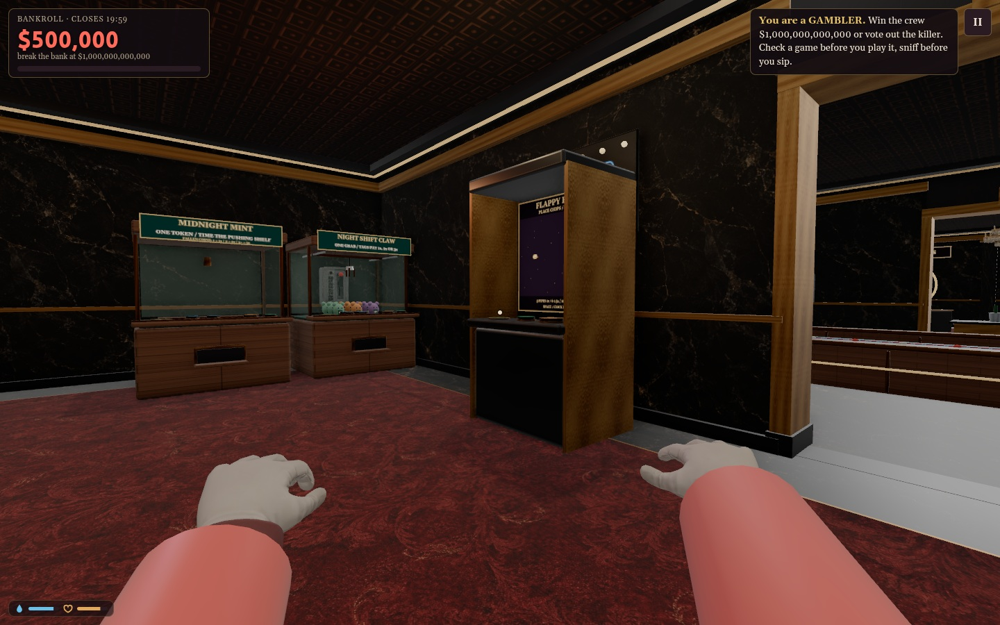
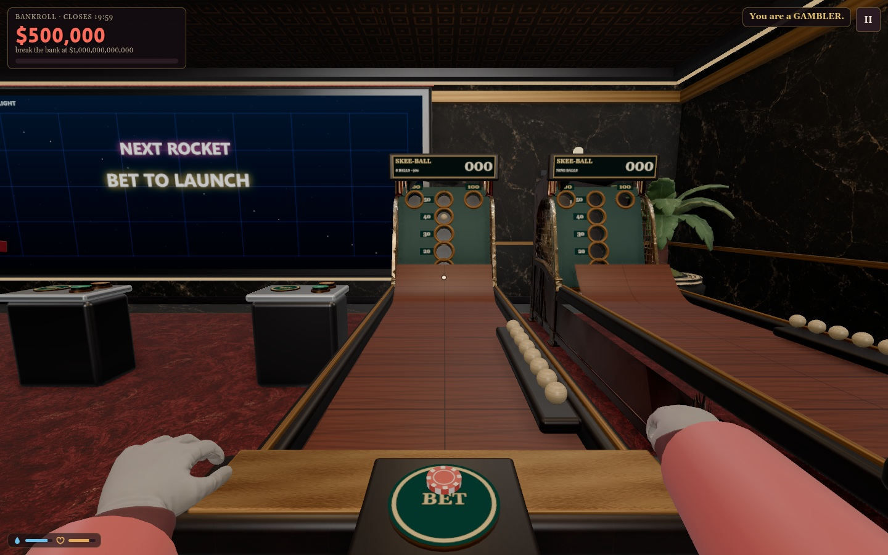
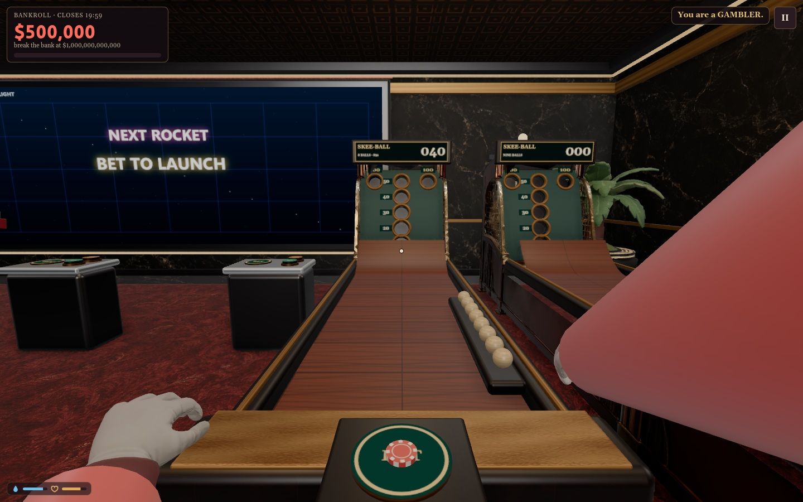

# Skeeball entry and arcade wall follow-up

2026-10-17. Implemented Steve's skee/Flappy corrections; the additional game list below contains proposals only.

Skee now tests where the ballistic sphere will cross the hole plane. The previous front-sphere contact test could bounce a shot whose actual path cleared the opening. Successful balls keep moving through the hole before dropping behind the target. The physical and rendered ball use the same 80 mm diameter; launch power covers a more useful range while high/side misses and real rebounds remain. Nine-ball scoring and payout tiers are unchanged.

Flappy moved from the open floor to the south wall, east of the duck doorway, facing north. Mines and Dragon Tower signs now sit over their actual machines. Flappy starts at .30 instead of .22 speed, rises to .43, and later pipes narrow from .28 to .21. Individual openings keep their size while visible. Gravity is stronger; payout thresholds remain 3 / 6 / 10 / 15 pipes. Skilled timing can still reach the top payout.

[Actual top-down plan](../casino-layout-top-down.png) · [Interactive floor plan](../casino-layout.html)

Verification: 16,281 aim/power probes reach all seven pockets and misses, 32 fixed-step comparisons, 25 protected rounds, ownership/replay/settlement/lifecycle checks. Normal and no-prop browsers check five sphere-sized rays per hole, every scored trajectory, actual held-Space 40-point roll, rendered entry position and physical Flappy controls. All 87 game positions and 2,418 navigation routes remain clear. Actual three-browser skee lanes and Flappy owner/spectator state and disconnect checks pass. Difficulty checks include eight gap collision boundaries, a 16-pipe precise run, an 11-pipe less precise run and zero-score idle/spam losses. Player acceptance remains open.

## Proposed next arcade games

| Game | Main action | Challenge |
| --- | --- | --- |
| Stack Attack | Tap to drop a moving block | Overhang is cut off; the tower gets narrower and faster. |
| Potato Dash | Jump or duck in an automatic runner | Hurdles, low beams and gaps arrive faster; short rounds reward clean streaks. |
| Crossroad Heist | Step across traffic and moving platforms | Read moving lanes and commit at the right moment. |
| Gold Hook | Tap to launch a swinging claw | Catch valuable targets while avoiding heavy junk that wastes the clock. |
| Brick Breaker | Move a paddle left/right | Real rebounds, narrow angles and faster balls clear a compact board. |
| Orbit Escape | Tap to hop between rotating rings | Time transfers through gaps while avoiding orbiting hazards. |
| Rhythm Vault | Tap on the beat | Perfect hits build a streak as patterns become more complex. |
| Tilt Maze | Steer a rolling marble | Short physical mazes with holes, slopes and time pressure. |

Recommended first: **Stack Attack**, **Potato Dash** and **Crossroad Heist**. They add three distinct skills and work well as quick cabinet games.
