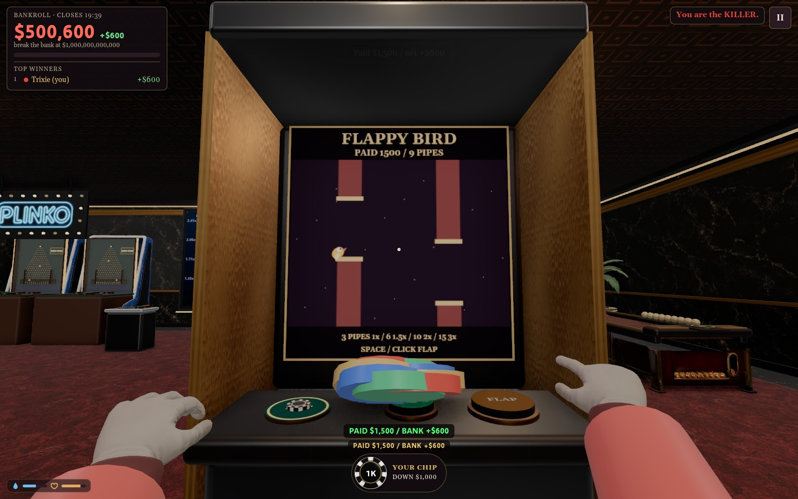
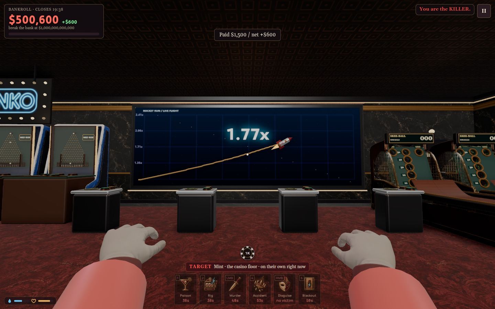
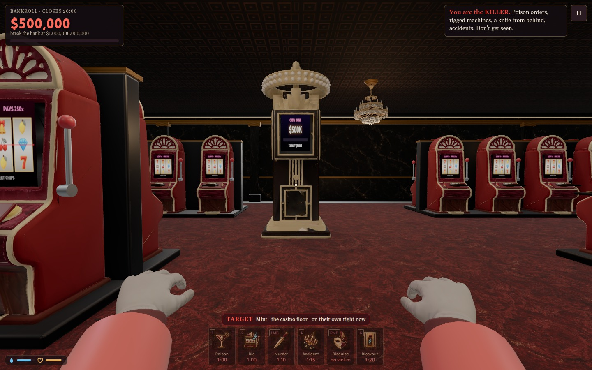
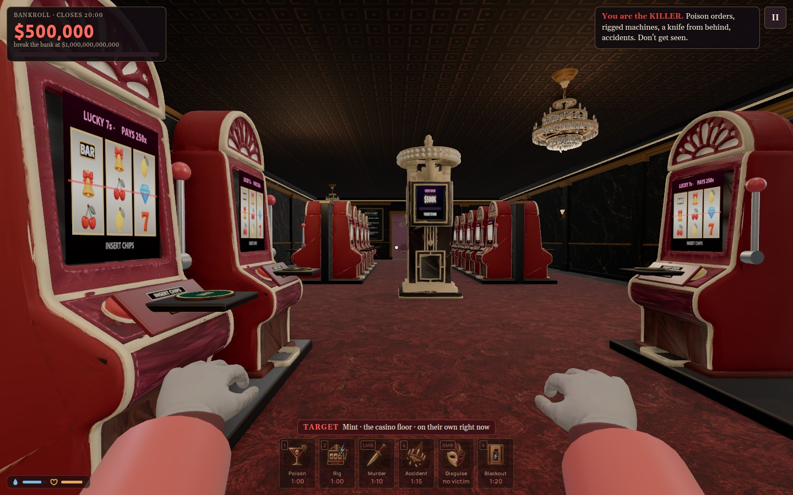
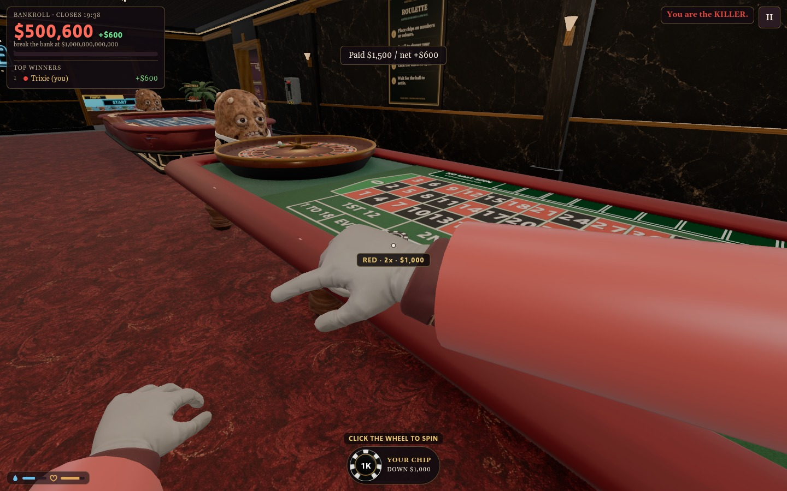
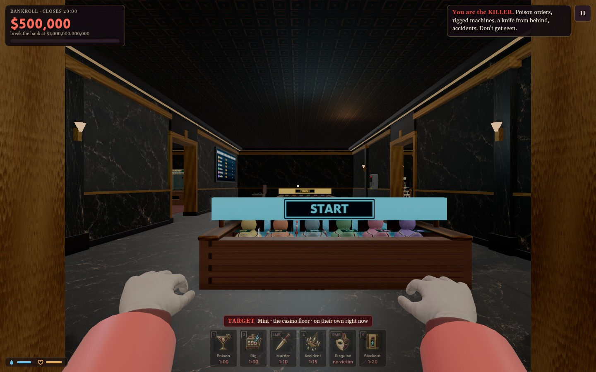

# Arcade and slot hall follow-up — October 17, 2026

- Duck Derby START immediately raises the gates. No player countdown remains; the race and payout are still owned by the host.
- Skee-ball rolls along the wood lane, loses energy on the curved ramp, leaves at its tangent, follows gravity and rebounds from the solid board/rails. Only a real opening scores. The ball grain rotates with distance. Protected rolls choose their launch energy before moving; there is no mid-flight steering. Existing nine-ball rounds and payout tiers remain.
- Original Flappy Bird cabinet in the arcade: place chips, START, then Space, controller A or click FLAP. Avoid the pipes and floor/ceiling. Three pipes return 1x, six 1.5x, ten 2x, fifteen 3x; one round lasts up to 45 seconds. The host validates input sequence, collision and one-time bank credit. Graphics and bird are locally authored; no paid generation.
- Four double-sided banks now hold 40 public penny machines. Four high-limit machines remain in VIP. Main/end aisles stay open. Continuous 2.2m cabinets and their bank footprints block witness sightlines, including actual murder evidence; hearing remains governed by the existing sound rules.
- DICE wall sign is on solid wall north of the doorway. Dice table model rotated; the coin game beside the shady shop now faces the lounge with its title and player approaches on the north side.
- Roulette uses its numbered/colored felt with real chip stacks. Removed the redundant betting circles.
- Rocket Run starts with AUTO OFF. Its chrome/oxblood/gold rocket and tubular rising trail are actual scene meshes in front of the display, with a physical crash burst. Payout/multiplier still use the host's existing rocket round.

## Previews

[Updated interactive floor plan](../casino-layout.html) · [Top-down PNG](../casino-layout-top-down.png)

## Verification

Native rules exercise all seven skee pockets/misses over 16,281 aim/power samples, 213 independent ballistic samples, physical rebounds, Flappy wins/misses/real bank credit, instant race start, ownership/replay/lifecycle and actual murder visibility. All 87 occupied game positions and approaches pass 2,418 routes from every public door and staff exit. Actual physical controls, Space, roulette felt betting, zero roulette circle instances, nine dice-door clearance rays and both graphics modes pass. Three-browser Flappy guest/spectator/disconnect transport and existing coin-pusher/claw regression pass. Skee keyboard, mouse and simulated standard-controller inputs pass, with zero first-use shader/static-buffer uploads. Eight affected-room/game/transition/crowd scenarios have zero page errors/repeated asset URLs and stable resources across six restarts. Physical controller hardware and player visual acceptance remain separate.

Reports: docs/performance/2026-10-17-arcade-followup-*.json, 2026-10-17-skee-physical-*.json and 2026-10-17-flappy-network.json. This is functional/visual inspection evidence, not a claim of unchanged scene cost or hardware acceptance.
