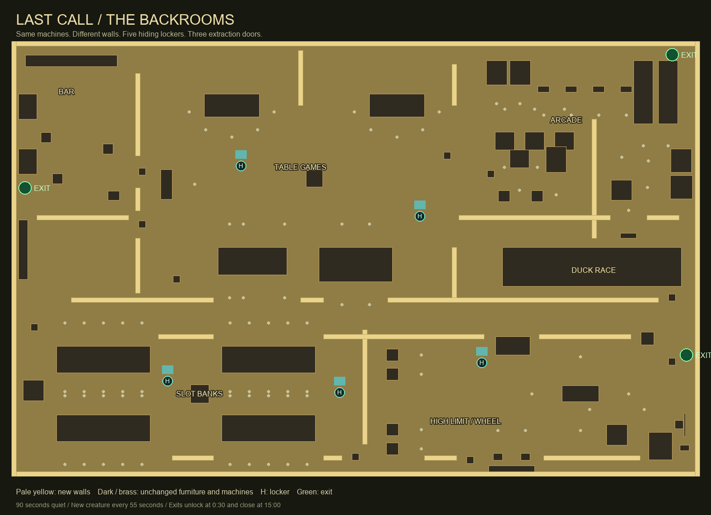

# Last Call / The Backrooms

Escape is now the Backrooms survival mode. Murder Mystery keeps its casino and killer rules. The title screen shows the modes on the left and right, animates the dividing line, art and play controls when selected, supports arrow-key selection and reduced motion, and keeps both choices visible at narrow widths.

## Play

- Everyone starts as a gambler. No killer assignment, perk selection, meetings, sabotage objective or breaker hunt.
- Machines, their controls and their seating coordinates are shared verbatim with the casino: all 92 positions stay put. The Escape maze uses 25 wall rectangles (including the perimeter), yellow wallpaper, continuous damp carpet and a low fluorescent ceiling. Solid abandoned furniture becomes matching pillars. Five usable lockers provide hiding places.
- The first **90 seconds** have no roaming entities or active mimic attacks. A creature arrives at 1:30, then another every **55 seconds**, up to eight. These are initial tuning values, pending Steve's playtest.
- **Bacteria** patrols and chases on sight. **Hounds** hear movement through walls, especially sprinting. **Smilers** stop moving while a visible player watches them. **Skin-Stealers** stalk on sight. The creatures follow the actual maze and search the last known position before returning to patrol.
- Break line of sight, approach a locker, and **left click to hide**. Left click again to leave. Your character disappears, movement freezes and you cannot operate nearby machines. A creature that saw you enter can still catch you; the game warns you. Legitimate rounds already running in the background can still settle.
- Six physical cabinets are secretly chosen as **machine mimics**. They remain dormant during the grace period. Actual use after that can trigger visible breathing and a 2.4-second warning: back away beyond the machine's reach. No Check Traps action or machine inspection in this mode. Mimics do not mark the other cabinets as safe.
- Three green exits unlock after **30 seconds**: the bar's west door, the arcade's north door and the VIP area's east door. Hold position at a marked door for **three uninterrupted seconds** to extract. Leaving resets the hold. A crowbar shortens it to two seconds.
- Extraction saves your personal spendable winnings. Later ghost play cannot change that saved amount. Your result reports what you kept; dying or missing the final exit loses the run. Other players can continue after you leave. Exits close at **15 minutes**.

Sneakers, crowbars and the one-use charm remain useful gear. The obsolete fuse kit is omitted. Existing machine betting limits and payouts remain; this change does not retune Murder Mystery's held balance/length candidate C02.

## Visuals and assets

[Split menu](menu.jpg) · [Narrow menu](menu-narrow.jpg) · [Arcade passages](arcade.jpg) · [Slot area](slots.jpg) · [Creatures](entities.jpg) · [Mimic](mimic.jpg) · [Hound death sequence](hound-death.jpg)

The menu's right-side image is a GPU render of this actual level, captured by [backrooms-menu-capture.mjs](../../tools/backrooms-menu-capture.mjs). [Provenance](menu-image-provenance.json). Existing Backrooms texture assets are reused. The four creature bodies, animation, mimic mouth and lockers are authored geometry, including the matching creature in the death cinematic. **No paid generation was used.**

[SVG plan](top-down.svg) · [actual layout data](layout.json). Pale walls are Escape geometry; brass/dark footprints are the existing machines and furniture; cyan H marks lockers; green marks extraction doors. The plan deliberately does not reveal dormant mimics or runtime spawn locations. Generated directly from the same geometry definitions as the game by [backrooms-plan.mjs](../../tools/backrooms-plan.mjs).

## Verification

- Native rules: all 92 machine coordinates unchanged; 1,236 routes / 6,390 swept-circle segments; all actual starts for 4–32 players; spawn grace and four types; hidden movement/action rejection; witnessed hiding; real entity and mimic deaths; warning/retreat; private dormant mimics; Smiler watching; Hound hearing through walls; remote wall crossing rejection; interrupted extraction; saved wallet; deadline; packed guest state; Murder Mystery rules regression.
- Actual GPU/browser checks run on ml350, in normal and no-prop graphics: split menu at 1440/740/420 widths, selected Escape setup, real left-click locker entry/exit, frozen movement, rendered creatures and mimics, real extraction, matching Hound cinematic, and restoration of the casino's original material identities and layer masks.
- Real three-browser PeerJS: host-selected mode, guest hiding, observer visibility, timed spawn transport, shared mimic warning, guest retreat/extraction, private creature death and per-player result.
- Full bot runs at 4, 16 and 32 players reach an end state without exceptions. These are smoke checks, not balance certification. Existing arcade payout/physics and safety/phone rules also pass.

Evidence: [rules](../../docs/performance/2026-10-17-backrooms-survival-rules.json), [views](../../docs/performance/2026-10-17-backrooms-survival-views.json), [network](../../docs/performance/2026-10-17-backrooms-survival-network.json), [bot runs](../../docs/performance/2026-10-17-backrooms-bot-runs.json).

Delivery: [all 892 runtime files match the LAN preview by SHA-256](../../docs/playtest-build-backrooms-2026-10-17.json).

## What Steve should look for

Choose the left and right menu halves and watch the art, split and controls move. Play The Backrooms, compare the machine positions to Murder Mystery, and walk the new passages. Use a locker before and after a creature sees you. Watch a Smiler, then turn away. Try a machine after 1:30 and retreat if it breathes. Leave through a green door and check the amount saved. Creature difficulty, menu motion and the final appearance still need your playtest acceptance.
