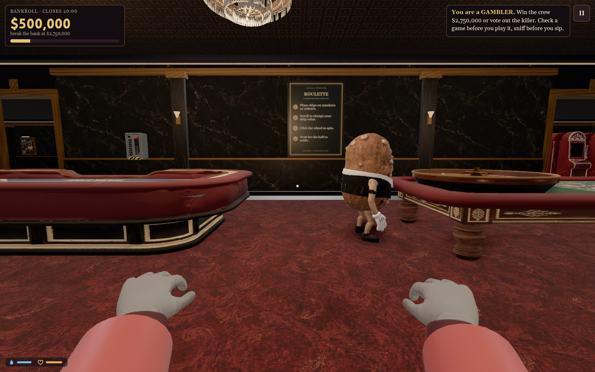
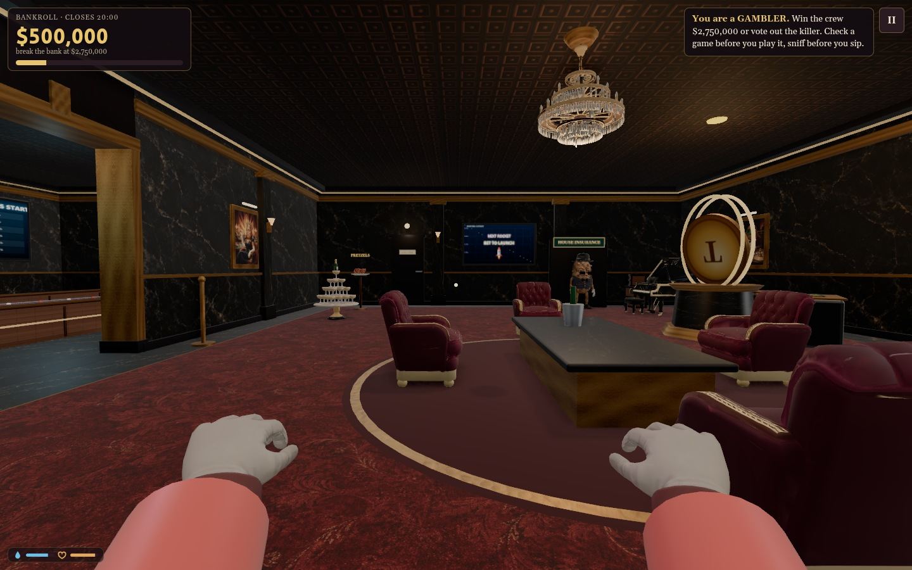
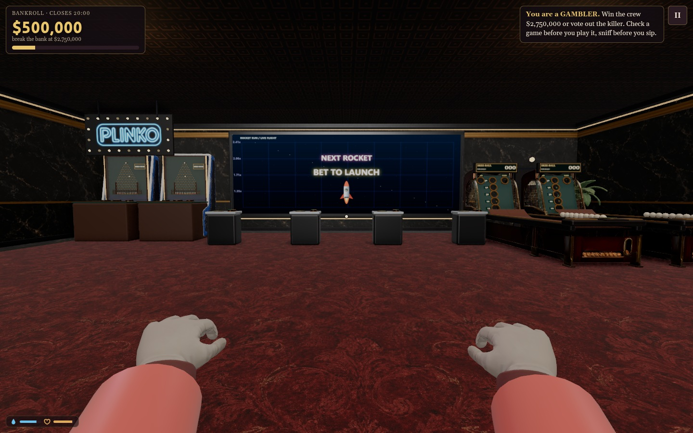

# Red, black and gold casino

Steve's supplied menu reference sets the architectural direction: oxblood fabric, near-black cracked stone with antique gold veins, aged brass/gold trim and warm pools of light.

The actual casino now uses black stone walls, wainscoting, columns and table stone; deep red damask carpet fields inside flush black-stone borders with fine gold inlay; burgundy lounge seating; darker lacquer and warm champagne coves/signs. Purple betting stands and pink/cyan decorative cabinet strips are replaced with black/gold/red. The lighting stays readable at the ordinary High preset, without requiring bloom or reflections. Existing authored game displays, betting colors, numbered ducks and playable props retain their cues.

The floor plan, obstacles, approaches, door gaps, camera paths and game rules are unchanged. Arcade walls keep their original flat clearance without adding columns behind cabinets or screens. Texture fallback mode uses deterministic black/gold stone and oxblood fiber canvases.

Two color textures were generated with the built-in image tool; exact prompts and preparation are in [texture-prompts.json](texture-prompts.json). No further Sorceress generation was used. Runtime maps are 1024px color and 512px normal. Polished stone uses a flat normal; carpet uses a seeded fine fiber normal. Existing generated material records remain in assets/mats/provenance.json.

Verification: actual first-person screenshots across nine views in normal, no-prop and procedural-material modes (27 views), shader/startup checks, the doorway/single-pedestal test and VIP clearance/use test. Evidence is in docs/performance/2026-10-17-casino-aesthetic.json. Blackout, monster, Backrooms, ghost camera and both escape-lighting states also pass with no page errors or repeated asset URLs, plus six restarts; see docs/performance/2026-10-17-casino-aesthetic-transitions.json. Selected current screenshots and matching before views are saved beside this file.

## Current in-game views

[Before: main floor](before-pit.jpg) and [before: VIP](before-vip.jpg).
