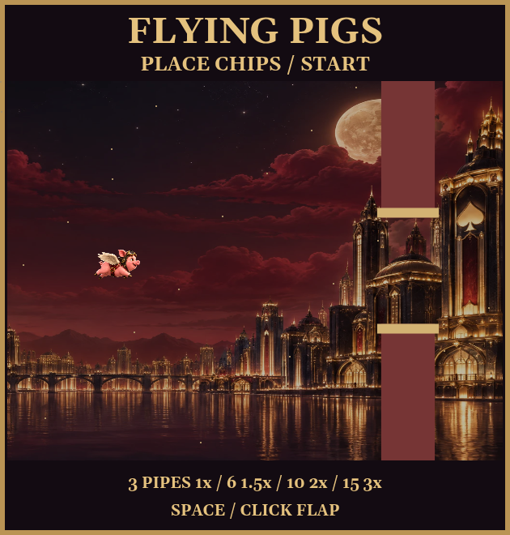
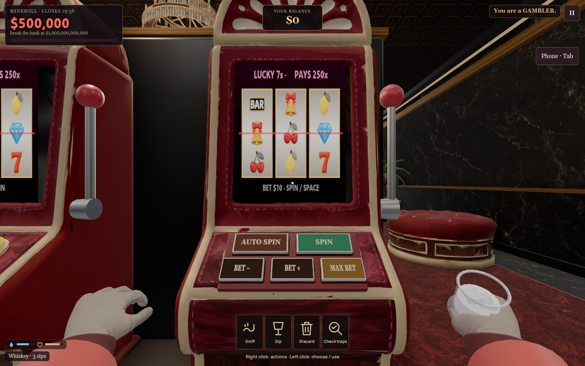

# Flying Pigs art, mouse actions and crowd ambience

Steve approved the generation batch on 2026-10-17. Both Sorceress images and all three ElevenLabs loops are generated and integrated. There are no pending generation jobs.

Sorceress: two 2K GPT Image 2.5 Sunburst images, **20 credits total ($0.20)**. The four wing poses were locally keyed into a transparent atlas. The sky image included an unwanted decorative pig despite the prompt; the shipped backdrop crops it out, retaining the red clouds and gold casino skyline. No extra paid takes were purchased. Exact prompts, job IDs and processing are in media-provenance.json.

ElevenLabs: three seamless 20-second crowd loops, sparse, medium and busy. The estimate was 720 credits; provider receipts report **726 actual credits** (242 each). All three are normalized to -28 LUFS, preloaded, and individually available in Settings > Sound.

Living occupants of the current room determine the blend, excluding the listener, hidden staff and escaped players. One guest uses the sparse layer, six the medium layer, and twelve or more the busy layer, with blends between these points. Every layer retains its own playback position, including during rapid population changes. Gain approaches the new mix over about four seconds; empty rooms fade out and stop playback after eight seconds. The quiet jukebox and machine/water ambience remain separate.

Right click opens the cursor for the shared bottom-center action icons. Left click selects Sniff, Sip, Discard, Check traps or a killer ability, then returns to play. Left click still uses world objects and machine controls. Right click on a betting spot still takes chips back; camera right click still exits. Optional existing shortcuts remain, while the HUD teaches mouse controls. Crew and killer actions share the same dock.

Render and actual-click checks cover normal/no-props graphics, drink sniff/discard, trap disarming, compact crew/killer dock, generated cabinet art, all three live audio layers, rapid population reversals, individual muting and empty-room cleanup. See docs/performance/2026-10-17-flying-pigs-controls.json. Earlier height, VIP breaker, phone and guest snapshot evidence remains in the safety-phone reports.

