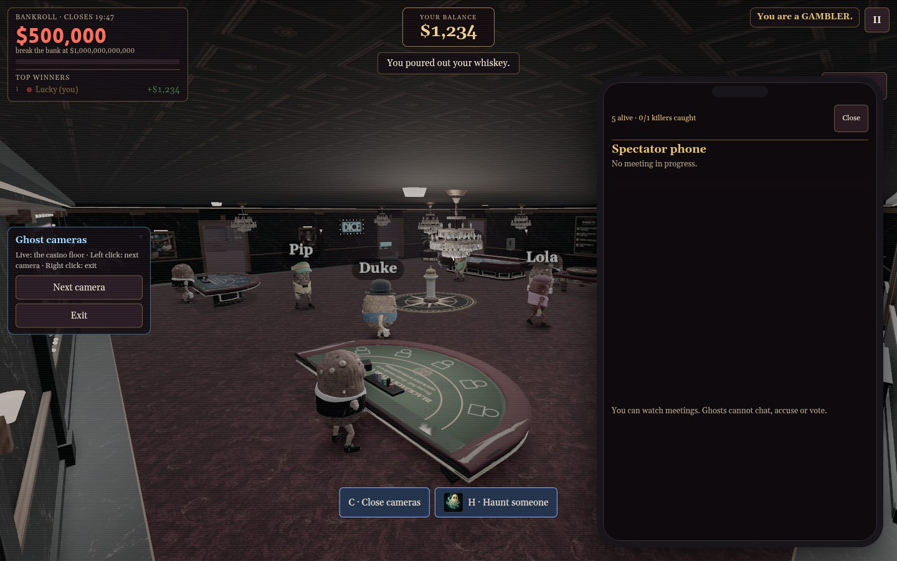
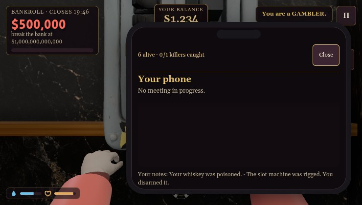

# Flying Pigs asset plan

No paid jobs submitted. The current renamed game uses a temporary drawn pig and retains the verified flight physics and payout rules.

The proposed Sorceress batch is two 2K images using GPT Image 2.5 Sunburst: a four-pose flying pig atlas (locally keyed for free) and a casino sky backdrop. Live catalog: 10 credits each, 20 credits total ($0.20). Prompts and exact inputs are saved alongside this file. No paid animation, 3D conversion, or additional takes are included.

The proposed ElevenLabs batch is three seamless 20-second crowd loops: sparse, medium and busy. Each dry-run estimate is 240 credits; total 720 ElevenLabs credits. Exact prompts are in generation-plan.json. Once approved, normalize the loops, integrate the three tiers, preload them and expose each recording in Settings → Sound.

Current audio behavior uses the existing ElevenLabs bar recording as the temporary crowd layer. It scales smoothly by living occupants of the listener’s room, excluding the listener, ghosts, escaped players and staff hiding in cameras; an empty room has no added crowd layer. Room machine/water ambience remains separate. The jukebox plays quietly throughout the casino and stops outside gameplay.

Runtime evidence: docs/performance/2026-10-17-safety-phone-{rules,views}.json and population-audio.json. Normal and no-prop views cover six machine heights, explicit drink sniff/discard and trap disarming, read-only ghost phone, clear VIP breaker approach and compact HUD spacing. Native checks cover confirmed killer counts and packed guest transport. All 87 seats / 2,418 navigation routes remain clear.

