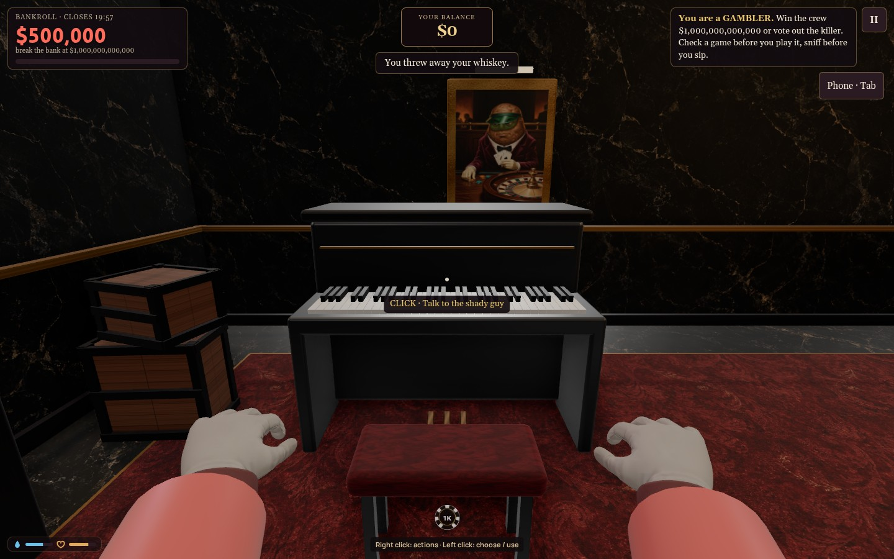
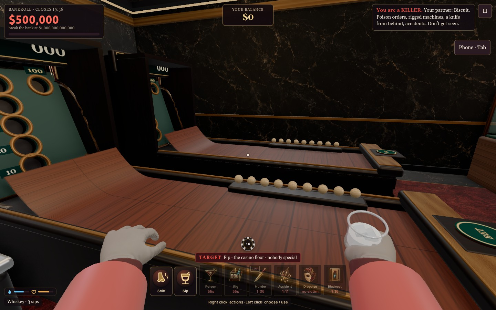
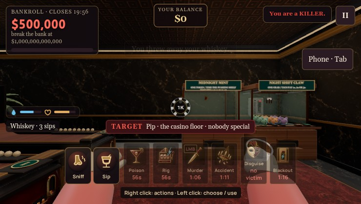
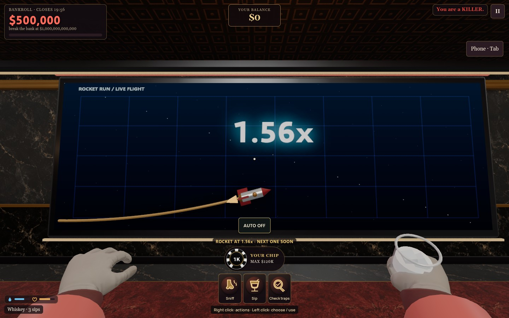
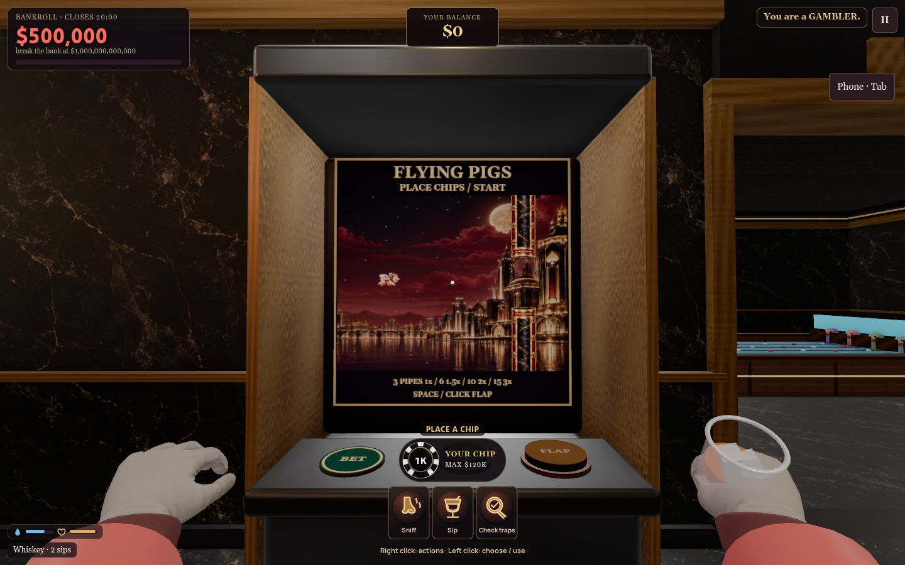
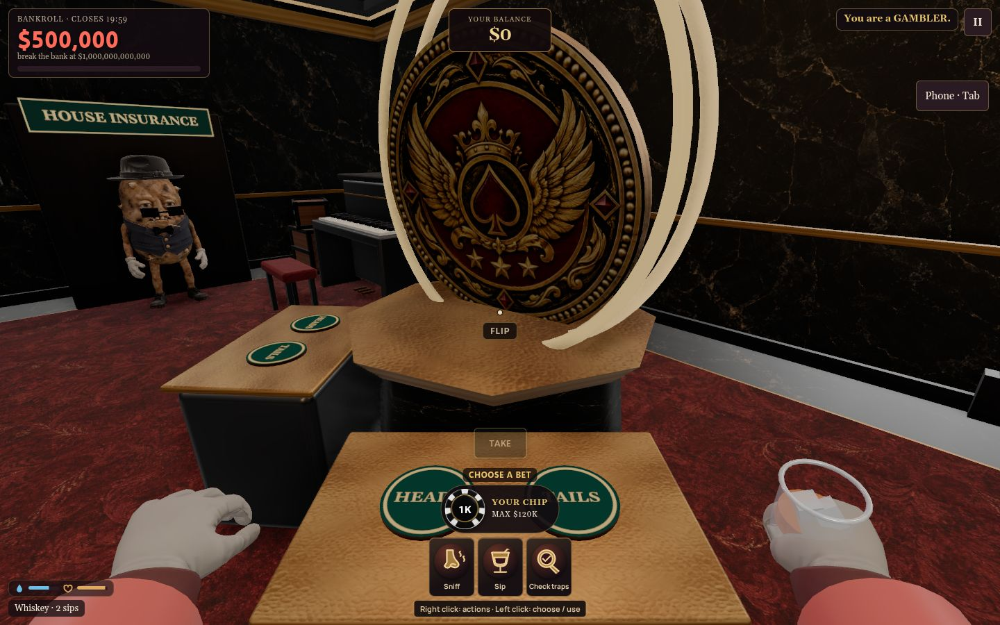
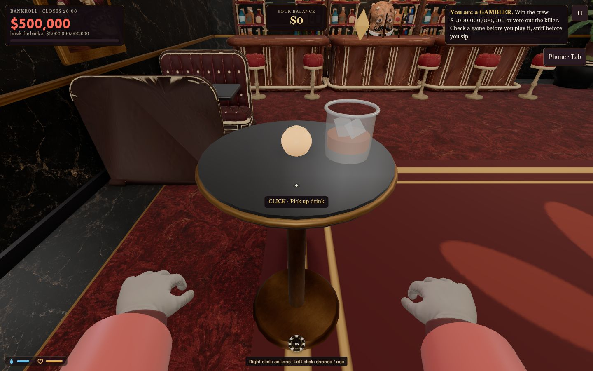
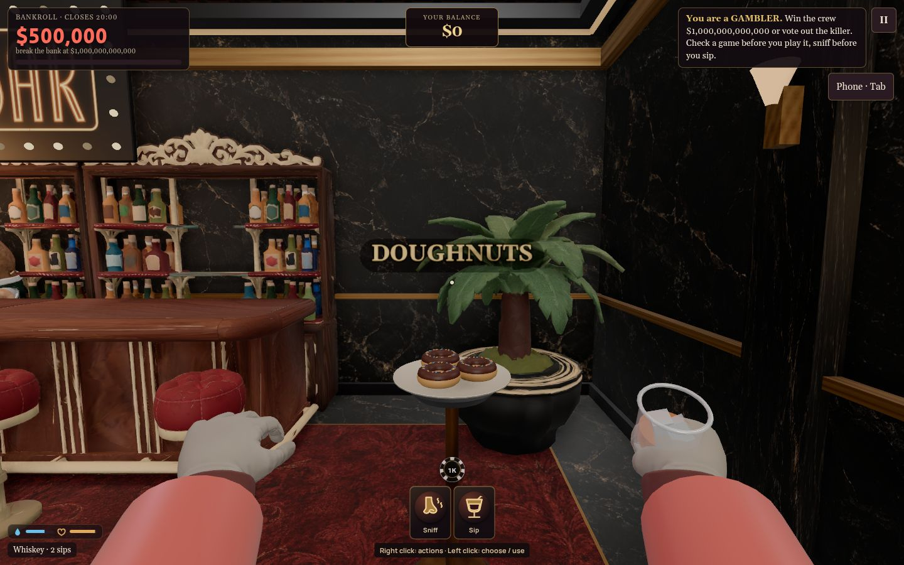
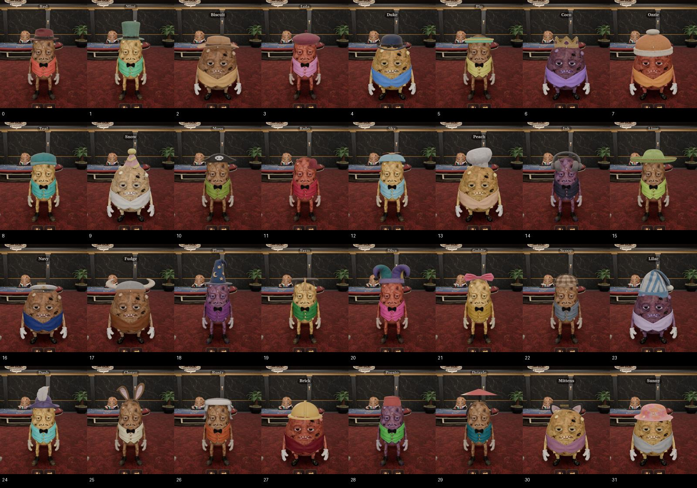

# Machine, controls and disposal follow-up — 2026-10-17

Implemented after Steve's visual/play feedback. The approved art batch and latest skee/table-drink/donut/hat repairs are complete; see the latest follow-up below.

- Drinks must be taken to a physical trashcan. Ten black/gold lined cans cover all seven rooms. Left-click the nearby can's context action to throw the drink away; the discard icon, touch button and X shortcut are removed. The host enforces reach and wall visibility even for an old client sending `pour`. Sniff and Sip remain in the shared action dock.
- Safety icons now use filled engraved gold silhouettes, burgundy medallions, consistent borders and compact labels; hover/focus/pressed/disabled states remain.
- Living first-person eye level is now a constant 1.55 m, raised from 1.12 m. Walking up to and using a machine never changes it. This addresses the low view across tall cabinets without moving machine controls or changing physical game geometry.
- Skee-ball now has continuous solid lower casing, target side panels, rear closure and roof in both graphics paths. The seven actual ball openings and physics stay functional.
- Rocket heading no longer comes from rounded payout increments. A smoothed display clock bridges host snapshots, and rocket/trail share a continuously rising fixed corridor. Removed the live-axis rescale that sent long flights down/back. Actual multiplier, outcomes and cash-out are unchanged.
- Replaced the damaged legacy piano model with a fitted black/gold upright: complete cabinet, 35 separate white keys, grouped raised black keys, three brass pedals and a burgundy bench. Every part fits the existing collision footprint and clears the shop stock. The retired legacy model is no longer downloaded at startup.
- Updated the actual [top-down map](../casino-layout-top-down.png) and [interactive plan](../casino-layout.html); T marks trashcans.

## Evidence

Native checks: all ten bin approaches, all seven rooms, 200 routes from every door endpoint to bins, remote disposal and disposal through a wall rejected. All 87 game positions / 2,418 existing navigation routes remain clear.

On ml350, actual left-click disposal, no discard icon, all 15 game types at the same height, complete piano bounds, 30-second rocket flight under 10 Hz snapshots with no backwards/downward motion, full and compact action docks, and normal/no-props screenshots pass. Skee rendered entry regression covers all seven holes and a real held-Space scoring roll; slot physical bets/spin/auto, Space, staff passages and camera mouse input pass in both graphics paths.

Reports: `docs/performance/2026-10-17-trash-rules.json`, `2026-10-17-machine-review-views.json`, `2026-10-17-machine-review-skee-entry.json`, `2026-10-17-machine-review-slot-input.json`, `2026-10-17-layout-routes.json`. These are implementation checks; Steve's look/feel acceptance remains open.

## Prepared new Sorceress batch — awaiting cost approval

Two `image_generate` calls using GPT Image 2.5 Sunburst at 2K, live catalog price 10 credits each, **20 credits / $0.20 total**:

1. [Flying Pigs pipes](pipes-input.json): cracked black stone / burgundy shaft and separate antique-gold mouth cap. Free local keying/cropping; render the cap mirrored for the upper obstacle. The existing pipe collision bounds and exact visible gap remain authoritative.
2. [Coin flip faces](coin-input.json): embossed gold potato gentleman HEADS and ornate casino crest TAILS, mapped onto the actual spinning 3D coin. Circular crops and free texture preparation. No additional paid 3D generation.

[Exact plan and review criteria](generation-plan.json). The previous batch generated the pig poses and skyline. This approved batch replaces the procedural pipes and H/T coin faces. No extra takes, paid keying or animation included.

## Approved follow-up — 2026-10-17

Steve approved the pending two-image batch. Actual Sorceress charge: **20 credits ($0.20)**, exactly the approved amount. Generated shaft/cap and both coin faces are shipped in assets/art2; [provenance](media-provenance.json) records jobs, prompts and output hashes. Pipe art is clipped to the existing host rectangle and gap, including cap width. Heads and tails use separate circular textures on the actual coin.

Skee ramp Euler integration caused discontinuous exit speeds at adjacent powers. The new energy-based ramp velocity removes the step-dependent jump and uses a playable launch range: a centered full charge reaches 50 rather than overshooting every hole. All seven holes, misses, nine-ball settlement, protected wins and owner/spectator behavior remain verified. **1,001** sampled powers now have monotonic lip speeds and uninterrupted individual scoring bands. Actual rendered entry and real held Space pass normal/no-prop; real three-browser lanes agree on scoring and payout.

All five bar tables (three high-tops, two booths) support left-click placement and pickup. Table IDs are host-owned and transported to guests; tabletop heights are real geometry heights. Sips, mix and poison persist. The contaminated generated donut (which included miniature floating characters) is replaced with food-only geometry. Generated hats now fit all dimensions, centered against their authored reference and sized to head crown radius. Umbrella/hardhat use correctly oriented authored forms because their legacy generated sources were the wrong shape. All 32 hats reviewed in normal and no-prop views.

[Proposed next games](../next-arcade-games.md) — Potato Stack, Vault Breaker and Last Train are the first recommended additions.

